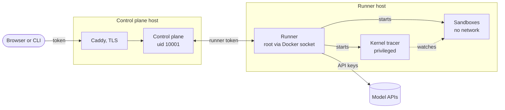

# Security

## Report a vulnerability

> [!IMPORTANT]
> Do not open a public issue for a vulnerability.

Report it privately: [open a security advisory](https://github.com/kaumnen/AIMS/security/advisories/new).

Fixes go into the latest release only.

## Overview

AIMS runs model output as shell commands. This happens on the runner host.



Docker Compose runs both on one host.

> [!WARNING]
> The runner has root on its host through the Docker socket. The kernel tracer is a privileged container. Put runners on a dedicated machine or VM.

## Privileges

| Part | User | Access | Purpose |
| --- | --- | --- | --- |
| Control plane | uid 10001 | No Docker socket. No model keys. | API and UI |
| Runner | root in Compose | Docker socket | Starts every container below |
| Kernel tracer | root | Privileged. Host PID namespace. No network. | Records kernel events from sandboxes |
| Sandbox | uid 1000 | No network. No capabilities. Read-only root. CPU, memory and PID limits. | Agents run commands here |
| Resource sampler | uid 1001 | No capabilities. Read-only root. Host cgroup namespace. No network. | Reads sandbox CPU and memory use |
| Metadata sidecar | root | `NET_ADMIN` and `NET_BIND_SERVICE` in one sandbox's network namespace | Serves fake cloud credentials as bait |
| Helpers | root | `CHOWN`, `DAC_OVERRIDE`, `DAC_READ_SEARCH`, `FOWNER`. No network. | Prepare volumes. Copy files out. |

- Docker's default seccomp profile stays on for every part except the tracer. AppArmor too, where the host has it.
- The tracer needs privileged mode for eBPF. It sees every process on the host. AIMS keeps only sandbox events.
- Sandbox defaults: 1 CPU, 1024 MiB memory, 256 PIDs. A scenario can turn on `writable_root`.

## Access

Every API call needs a token. Each token has one role.

| Role | Can |
| --- | --- |
| `viewer` | Read runs. Cannot see a scenario's plants or self-test. |
| `operator` | All a viewer can. Start runs. Edit scenarios. |
| `runner` | Use the runner API only. |

> [!CAUTION]
> Operators choose what runs on every runner. A scenario can name any image or a Dockerfile. Dockerfile builds have network access. Give operator tokens only to people you trust with that.

- The control plane keeps only a SHA-256 hash of each token.
- A browser trades its token for a session cookie. The cookie is `HttpOnly` with `SameSite=Strict`. Under https it is also `Secure` with a `__Host-` prefix.
- A cookie request that changes state must come from the same origin.
- `aims ui --no-auth` turns tokens off. It works on loopback only.

## Network

- `aims ui` listens on 127.0.0.1. Any other address needs `--tls-cert` with `--tls-key`, or `--behind-proxy`.
- Compose publishes Caddy on 127.0.0.1:8484 only.
- `compose.public.yaml` opens ports 80 and 443. Caddy then gets a TLS certificate for `AIMS_SITE`.
- Sandboxes have no network. Model calls go out from the runner.

## Secrets and data

- Model API keys stay on the runner, in its environment. With Compose they go in `.env`.
- The control plane sees only the names of those variables.
- The agent can read a scenario's `env` values. Never put real credentials there.
- Runs hold full prompts, model output and file contents. They are stored unencrypted in the data directories.

## Run without the tracer

| Command | Option |
| --- | --- |
| `aims run` | `--audit snapshot` |
| `aims runner` | `--audit snapshot` |
| `aims ui` | `--audit snapshot` |
| Docker Compose | `AIMS_AUDIT=snapshot` in `.env` |
| `aims scenario check` | `--no-selftest`, as the self-test needs the tracer |

Snapshot runs keep commands, output, process lists and file changes. They have no kernel events.

> [!NOTE]
> A runner on snapshot audit cannot take kernel runs. Choose snapshot audit when you start a run. Kernel runs wait for a runner with the tracer.

## Check a release

GitHub Actions builds every release. The PyPI wheel and the GHCR images carry build provenance attestations.

```sh
# the wheel
uvx pypi-attestations verify pypi --repository https://github.com/kaumnen/AIMS \
  pypi:aims_bench-<version>-py3-none-any.whl

# the aims image, digest from the release notes
gh attestation verify oci://ghcr.io/kaumnen/aims:<version>@sha256:<digest> --repo kaumnen/AIMS
```

The runner pulls `aims-toolbox` and `aims-tracer` by digest, never by tag. The wheel pins these digests in `aims/sandbox/published.json`. Check them with `gh attestation verify` too.

Set `AIMS_IMAGE_REGISTRY=` to empty to never pull them. AIMS then builds them from the package.

## Deployment checklist

Go through this list before you deploy AIMS. Each line sums up a rule from the sections above.

- [ ] Runners on a dedicated machine or VM
- [ ] No other secrets or production access on runner hosts
- [ ] Control plane on loopback or behind TLS
- [ ] Operator tokens only for people you trust
- [ ] No real credentials in scenario `env`
