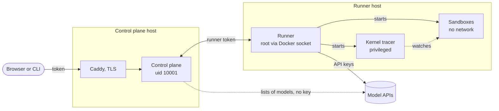

# Security

## Report a vulnerability

> [!IMPORTANT]
> Do not open a public issue for a vulnerability.

Report it privately: [open a security advisory](https://github.com/kaumnen/AIMS/security/advisories/new).

Fixes go into the latest release only.

## Overview

AIMS runs model output as shell commands on the runner host.



Docker Compose runs both on one host.

> [!WARNING]
> The runner has root on its host through the Docker socket. The kernel tracer is a privileged container. Put runners on a dedicated machine or VM.

## Privileges

| Part | User | Access | Purpose |
| --- | --- | --- | --- |
| Control plane | uid 10001 | No Docker socket. No model keys. In Compose: no capabilities, read-only root. | API and UI |
| Caddy | root | In Compose: `NET_BIND_SERVICE` only, read-only root. | TLS and proxy to the control plane |
| Runner | root in Compose | Docker socket. `no-new-privileges` in Compose. | Starts every container below |
| Kernel tracer | root | Privileged. Host PID namespace. No network. | Records kernel events from sandboxes |
| Sandbox | uid 1000 | No network. No capabilities. Read-only root. CPU, memory and PID limits. | Agents run commands here |
| Resource sampler | uid 1001 | No capabilities. Read-only root. Host cgroup namespace. No network. | Reads sandbox CPU and memory use |
| Metadata sidecar | root | `NET_ADMIN` and `NET_BIND_SERVICE` in one sandbox's network namespace. 0.5 CPU, 128 MiB memory, 64 PIDs and 32 connections. | Serves fake cloud credentials as bait |
| Helpers | root | `CHOWN`, `DAC_OVERRIDE`, `DAC_READ_SEARCH`, `FOWNER`. No network. | Prepare volumes. Copy files out. |

- Docker's default seccomp profile stays on for every part except the tracer. AppArmor too, where the host has it.
- Commands in a sandbox also run under AIMS's own seccomp filter. It refuses io_uring, which Docker allows before 25.0 or with a custom profile, and every 32-bit or x32 call. Ops sent through io_uring and 32-bit calls can skip kernel records.
- The tracer needs privileged mode for eBPF. It sees every process on the host. AIMS keeps only sandbox events.
- A runner stopped with SIGKILL leaves its tracer and sandboxes running. Their volumes with the run's files stay too. The next AIMS start on that host removes them. To clean up a host you retire, remove the containers first, then the volumes:

  ```sh
  docker rm -f $(docker ps -aq --filter label=aims.managed=1)
  docker volume rm $(docker volume ls -q --filter label=aims.managed=1)
  ```
- Sandbox defaults: 1 CPU, 1024 MiB memory, 256 PIDs. A scenario's `sandbox` section changes them.
- The `/work` volume has no size limit, so an agent can fill the host disk with real bytes.

## Access

Every API call needs a token. Each token has one role. Two calls need none:

- Sign-in. It takes a token or a launch code.
- `GET /healthz`. It answers only `{"ok": true}`, for container healthchecks.

The API schema at `GET /api/openapi.json` needs a viewer or operator token.

| Role | Can |
| --- | --- |
| `viewer` | Read runs. Cannot see scenario files, plants, scores or self-tests. |
| `operator` | All a viewer can. Start runs. Edit scenarios. |
| `runner` | Use the runner API only. |

> [!CAUTION]
> Operators choose what runs on every runner. A scenario can name any image or a Dockerfile. Dockerfile builds have network access. Give operator tokens only to people you trust with that.

- The control plane keeps only a SHA-256 hash of each token.
- A browser trades its token for a session cookie. The cookie is `HttpOnly` with `SameSite=Strict`. Under https it is also `Secure` with a `__Host-` prefix.
- A cookie request that changes state must come from the same origin.
- `aims ui --no-auth` turns tokens off. It works on loopback only.
- `aims token list` and **Settings** > **Tokens** show when each token was last used, to the minute. A token never used shows `never`.

## Audit log

The control plane keeps an audit log in `server.sqlite`. It records each change sent to its API, refused ones too. It also records each sign-in, sign-out and failed sign-in.

- A row holds the time in UTC, the token name and role, how the caller signed in, the action, its target, the outcome with the HTTP status, the client address and a short detail.
- Rows never hold token values, launch codes, passwords or file contents.
- Reads, runner traffic and requests without a valid token are not recorded. Failed sign-ins are the exception.
- Behind a proxy, the client address comes from `X-Forwarded-For` only when the request comes from an address given to `--behind-proxy`.
- `aims token create` and `aims token revoke` on the server's machine are recorded too, as `cli`.
- Each pass of `aims ui --keep-days` that deletes runs leaves one `run.prune` row.
- Rows stay 90 days. `keep_days` under `[audit]` in a config file changes that. 0 keeps every row.
- Operators read it under **Settings** > **Audit**, with `aims audit` on the server's machine, or from `GET /api/audit`. `?format=jsonl` or `aims audit --jsonl` exports it as JSON Lines.

## Network

- `aims ui` listens on 127.0.0.1. Any other address needs `--tls-cert` with `--tls-key`, or `--behind-proxy`.
- Compose publishes Caddy on 127.0.0.1:8484 only.
- `compose.public.yaml` opens ports 80 and 443. Caddy then gets a TLS certificate for `AIMS_SITE`.
- The control plane refuses a request body over 8 MiB, or 16 MiB on the runner API, before it checks the token. Uploads have their own limits: 64 MiB per scenario file, 2 GiB per blob, 4 GiB per run import.
- Sandboxes have no network. Model calls go out from the runner.
- Runners, the CLI and model calls use `HTTPS_PROXY`, `HTTP_PROXY`, `ALL_PROXY` and `NO_PROXY`. Loopback never goes through a proxy.
- **Add a model** in the app reads a model server's list of models from the control plane, with no key. `aims models add` does the same from its own machine. The read may go to any http or https URL, loopback and private ones too, for local model servers. It follows no redirects.
- That read refuses a host when any address it resolves to is link-local or a cloud metadata service, such as `169.254.169.254`. The check runs as each connection opens. The connection then goes only to the addresses it checked. Through a proxy, the proxy resolves the host again. A name that the control plane or the CLI's machine cannot resolve goes to the proxy unchecked.
- An operator sees the HTTP status or the error. From a list of models they see the count and up to 20 ids like the one they typed. They never see the body.
- The guard covers only this read. The model check and every run call a profile's URL with its key, from a runner or the CLI's machine. A key goes only to the URLs that `AIMS_KEYS` lists for it.

## Secrets and data

- Model API keys stay on the runner, in its environment. With Compose they go in `.env`.
- `AIMS_KEYS` on the runner lists the URLs each key may go to. AIMS sends a key nowhere else. It reads no other env var for a model's URL or key. See [Keys](https://github.com/kaumnen/AIMS/blob/main/docs/models.md#keys).
- Only the environment and `--key` set `AIMS_KEYS`. No config layer and no edit in the app can change it.
- A profile with a `base_url` and no key needs no entry. The runner calls its URL without a key.
- The control plane sees the names of the listed variables and the URLs listed for them. It never sees a key.
- A profile URL with a user name or password is refused, since runs record the URL.
- The agent can read a scenario's `env` values. Never put real credentials there.
- Runs hold full prompts, model output and file contents. They are stored unencrypted in the data directories.

## Run without the tracer

| Command | Option |
| --- | --- |
| `aims run` | `--audit snapshot` |
| `aims runner` | `--audit snapshot` |
| `aims ui` | `--audit snapshot` |
| Docker Compose | `AIMS_AUDIT=snapshot` in `.env` |
| `aims scenario check` | `--no-selftest`, as the self-test needs the tracer |

Snapshot runs keep commands, output, process lists and file changes. They have no kernel events.

> [!NOTE]
> A runner on snapshot audit cannot take kernel runs. Choose snapshot audit when you start a run. Kernel runs wait for a runner with the tracer.

## Check a release

GitHub Actions builds every release. The PyPI wheel and the GHCR images carry build provenance attestations.

```sh
# the wheel
uvx pypi-attestations verify pypi --repository https://github.com/kaumnen/AIMS \
  pypi:aims_bench-<version>-py3-none-any.whl

# the aims image, digest from the release notes
gh attestation verify oci://ghcr.io/kaumnen/aims:<version>@sha256:<digest> --repo kaumnen/AIMS
```

The runner pulls `aims-toolbox` and `aims-tracer` by digest, never by tag. The wheel pins these digests in `aims/sandbox/published.json`. Check them with `gh attestation verify` too.

Set `AIMS_IMAGE_REGISTRY=` to empty to never pull them. AIMS then builds them from the package.

## Deployment checklist

Check these before you deploy. Each line sums up a rule above.

- [ ] Runners on a dedicated machine or VM
- [ ] No other secrets or production access on runner hosts
- [ ] `AIMS_KEYS` lists only each key's own provider URLs
- [ ] Control plane on loopback or behind TLS
- [ ] Operator tokens only for people you trust
- [ ] No real credentials in scenario `env`
